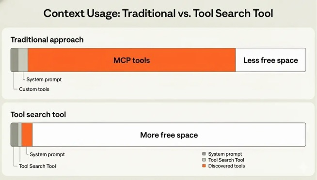
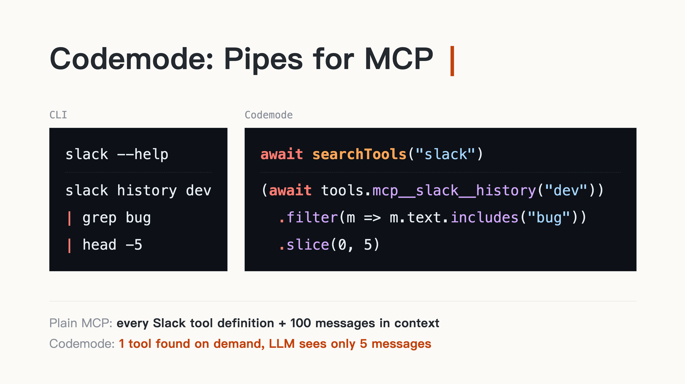
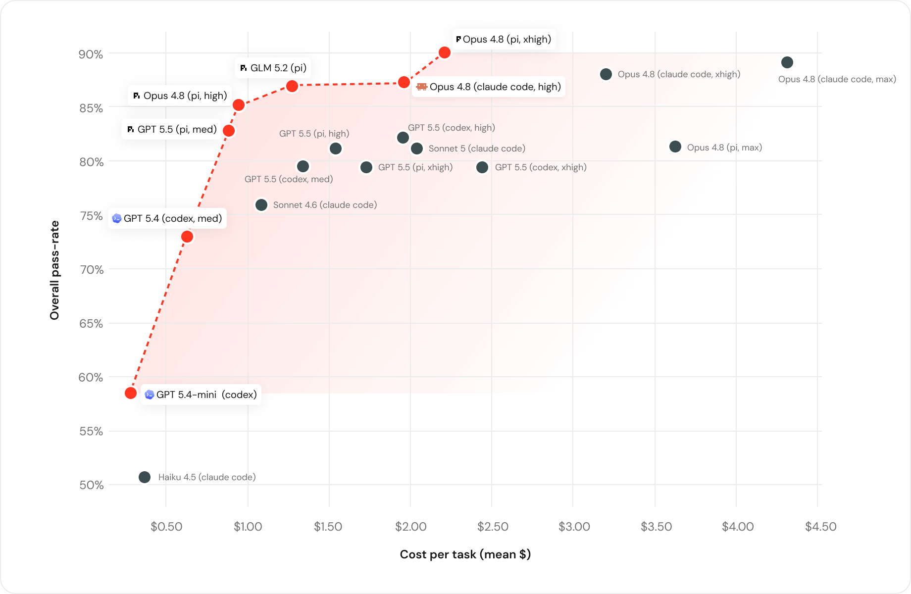
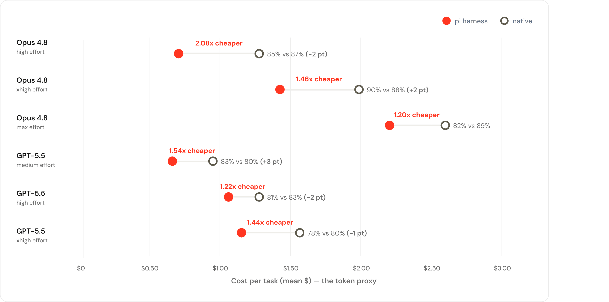
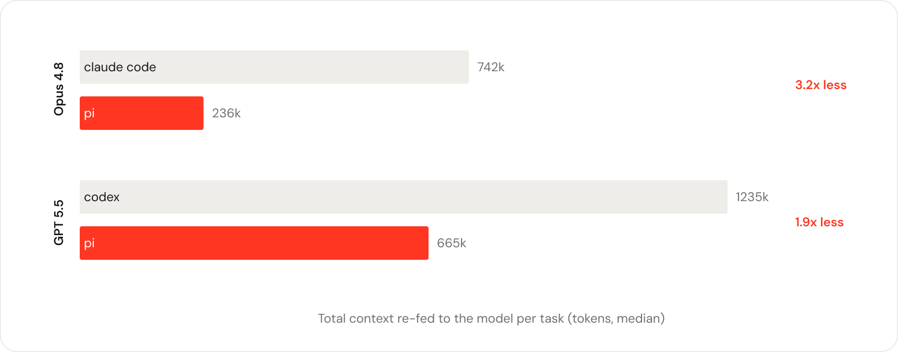
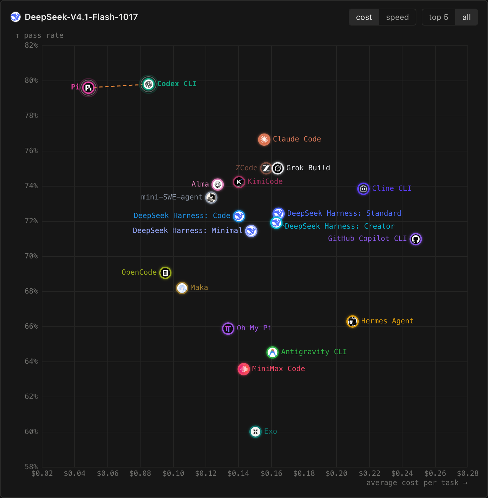

# Pi sharing

- 参考：
  - https://changchen.me/categories/pi/
  - https://www.youtube.com/watch?v=aGIUg8zKI8A
- Audience:
  - data engineering team - knowledge sharing
- Slides （20m）
  - 开头
    - 
  - good bye claude，hello pi
  - What is Pi
    - 
    - history of Pi - 三个人是谁 （问题⭐️）
      - Armin Ronacher @mitsuhiko
        - 
      - Mario Zechner @badlogic
        - 
      - Peter Steinberger @steipete
        - 
    - Timeline

        | Date | Who | Milestone |
        | --- | --- | --- |
        | 2009 | Mario | Starts libGDX, a cross-platform Java game framework (used by Slay the Spire) |
        | 2010-04 | Armin | Creates **Flask**, which began as an April Fools' joke |
        | 2016 | Armin & Mario & Peter | 奥地利 - Mario 在维也纳先后见到 Armin 和 Peter<br>原文说 2016 年某天他在维也纳 Sentry 的办公室和 Armin 第一次线下见面，喝了杯咖啡，从那天起成了朋友。同一天他又去 Peter 的维也纳办公室找了他，Peter 给他烤了块很大的牛排（一直很夸张）。 |
        | 2025-03 | Armin | Leaves Sentry after 10 years<br>Co-founds **Earendil** (PBC) |
        | 2025-11 | Mario | First public release of Pi |
        | 2026-02 | Peter | OpenClaw & joint opanai |
        | 2026-04 | Mario | Joins Earendil, bringing Pi with him |
        | 2026-09 | Armin | Adds Codemode and MCP support |
        | 2026-10 | Mario | Pi 1.0 and Pi Durable ship together |

      - jinja - uds binary config file stored in df
      - Pi 的结构
        - ```javascript
          // 2025-11
                       pi-coding-agent
                         /      \
                  pi-agent-core  pi-tui
                         |
                       pi-ai

          // 2025-12
                     pi-mom    OpenClaw(Peter)
                         \      /
                       pi-coding-agent
                         /      \
                  pi-agent-core  pi-tui
                         |
                       pi-ai

          // 2026-11
             OpenClaw                                 DeepSeek Harness
                |                                         |
                |     pi-coding-agent        pi-durable   |
                |    /       |     \          /     |     |
              pi-tui    pi-agent-core  pi-codemode  |     |
                             |                      |     |
                             +-----------+----------+-----+
                                         |
                                       pi-ai
          ```
  - Why - 瘦身：
    - 新 session （hi）
      - 典型 agent，大 system prompt 加几十个工具（by default）
        - 图片对比。
      - 小的 system prompt + 4 tools （工具输出截断）
      - Code is all you need（cli）
        - Atlassian cli
      - MCP in a Modern LLM
        - Prompt Cache
          - pi make prefix（前缀）稳定
        - New features （LLM）
          - 在对话中途调整 thinking level
          - tool 延迟按需加载
            - 
          - 在对话中途插入 system message
        - Pi Update
          - [Tool exposure](https://github.com/earendil-works/pi/blob/v0.99.2/packages/coding-agent/docs/extensions.md#tool-exposure)
          - Code Mode
            - 
        - Benefit
          - 只看保存最终结果
          - 例子 - 用 jev 判断模型
      - cache warmer
        - Claude 默认 TTL 只有 5 分钟
        - GPT 30m
      - session tree
    - 看得见账
      - 左下角解释
      - /session
    - bench mark
      - https://www.databricks.com/blog/benchmarking-coding-agents-databricks-multi-million-line-codebase
      - 文中和分享相关的三张图：
        - 成本 vs 通过率（Cost vs. Performance）

          
        - Harness 对效率的影响（同模型换 harness 的对比）

          
        - 每个任务重复喂给模型的 context 总量

          
      - https://frontierharness.org/live/
        - 同一个模型（DeepSeek-V4.1-Flash）换 harness：通过率 vs 每个任务平均成本

          
  - How
    - pi 热度在 optiver
    - 写一篇食用指南
- 其他
